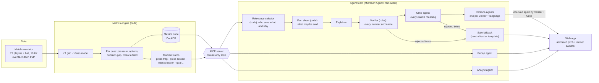

# Time and Space

**How much time and space does the player on the ball really have, and what does it cost the team
when they don't?** Time and Space measures the pressure on every pass from tracking data, links it to
the threat the pass adds or loses, and has a team of AI agents explain the key moments to each viewer
in their own way: a casual fan, an analyst, a supporter of either club, or the follower of one
player, in their own language. Every number in every text is checked against the data, and every
claim is reviewed by a Critic agent before anyone sees it.

Built for the Microsoft *Inside the Game* hackathon (category: Best Multi-Agent System).
All clubs, players and matches are fictional and simulated.

```bash
docker compose up --build        # then open http://localhost:8000  (no key, no cost, offline)
```

<!-- screenshot: docs/screenshot.png (to add) -->

## The idea: pressure → decision → threat

For every pass, from 10 Hz tracking of all 22 players and the ball:

| Measure | What it is |
|---|---|
| **Pressure** on the passer | from the nearest defender's distance (1 = within 1 m, 0 = nobody within 5 m) |
| **Passing options** | every teammate, with the chance the pass arrives (**xPass**, a model trained on the tracking) and the threat it would add |
| **Decision gap** | value of the best option minus the value of the chosen one |
| **Threat added (xT)** | change in the chance of scoring soon (expected-threat grid built from the season) |

Put together over a season, they show what pressure does to a team. League-wide, threat added
per pass by pressure on the passer (the Analyst agent's answer in the demo):

| Third | no pressure | some pressure | high pressure |
|---|---|---|---|
| final third | +0.0009 | −0.0062 | −0.0095 |
| middle third | +0.0001 | −0.0014 | −0.0029 |
| defensive third | +0.0001 | −0.0002 | −0.0009 |

Each pressing moment is then read against that curve, at its own spot on the pitch. For example: *"Under high
pressure in midfield the average pass loses threat (−0.0029); this one added +0.0433, more than 99% of
the 13,767 league passes in the same situation."*

## Architecture



**How a moment becomes a personal text**

1. **Selector (code)** ranks the match's moments for each viewer: importance × kind of moment × good or bad for
   their club × involvement of their player. It keeps their alert budget and records *why* each moment was picked.
2. **Fact sheet (code, not a model)** gathers what may be said: pressure in plain words, every option's xPass,
   the decision gap and its league percentile, the threat added and the league comparison in the same third,
   the score before and after. Facts come from the MCP tools, so the agents and the checks share one reference.
3. **Explainer agent** writes a neutral explanation from the fact sheet.
4. **Verifier (rules)** rejects any number not in the facts (rounding and percentages allowed) and any player or
   club not in the moment.
5. **Critic agent** (temperature 0) checks the meaning claim by claim: invented causes, wrong direction (who won
   the ball), size words that contradict the facts ("minimal" for a gap bigger than 94% of league passes). It can
   only reject, never add.
6. Rejections go back to the writer with the reasons; after two failures a **safe fallback** is shown and labelled.
7. **Persona agents** rewrite the verified text for each viewer, language and accessibility need. Each version
   goes through the Verifier and Critic again.

The **Recap agent** writes a match summary per viewer. The **Analyst agent** answers league questions by querying
the metrics cube through MCP. It reports sample sizes and confidence intervals, and says when a difference may be
noise. The workflow is a Microsoft Agent Framework `WorkflowBuilder` graph with switch-case edges (verify → critic
→ approve / retry / fallback) and fan-out to the persona agents.

## What the demo shows

Riverside Reds 4–1 Stonebridge Golds (fictional), 5 viewers:

| Viewer | Language | Detail |
|---|---|---|
| Casual fan | English | short |
| Analyst | English | deep |
| Riverside Reds fan | English | partisan |
| Stonebridge Golds fan | German | partisan |
| Follower of the top threat creator (Matteo Saltoro) | Spanish | plain language |

- **5 pressing key moments for every viewer**, including the 81st-minute chain: Riverside's press wins the ball →
  the next pass breaks Stonebridge's press → goal, 6.4 seconds in all.
- Each viewer's own **feed** (8 moments, with the reason for each), a **recap**, and 5 **analyst questions** on
  pressure and threat.
- On the pitch: the pressure ring around the passer, every passing option coloured by xPass, the chosen pass and the
  best option. Next to it: the league curve for that third with this pass on it.
- Next to every text: which checks it passed, what was rejected before it, and the facts it was allowed to use.

The model answers were recorded once with Azure AI Foundry `gpt-4.1-mini` (**$0.25** for the whole demo: 80 texts,
about 480 model calls over three recording rounds, including retries and Critic reviews) and are replayed from `demo/llm_cache.sqlite`. So the app
runs offline, free and identical for everyone. `python -m presslens.agents.demo check` proves the replay makes no
new model call and reproduces every text exactly.

## Does it measure the right thing?

The simulator keeps hidden ground truth that the engine never reads (`engine/data.py` refuses it).
Validation on 16 held-out matches (written to `data/engine/validation_report.md` by `presslens.engine build`):

| Engine estimate | vs hidden truth |
|---|---|
| xT grid (96 zones) | Pearson 0.964 |
| xPass (17,706 test passes) | correlation 0.920, AUC 0.823 |
| Decision gap | Spearman 0.436 |
| Pressure applied by each club (middle third) vs its true press intensity | Spearman 0.976 |

The engine also rediscovers the effect built into the players: under high pressure, low-composure players' decision
gap grows to 0.0041 (truth 0.0064) against 0.0032 for high-composure players.
Season realism (56 matches): 2.48 goals and 2.56 xG per match, 74% pass completion, 11.5 km per player
(`presslens.sim.realism`).

## Running

**Demo app (judges):** `docker compose up --build`, then http://localhost:8000. It's a small image with the
recorded demo only.

**Whole pipeline:** `docker compose --profile pipeline up --build pipeline` simulates the season, builds the engine,
replays the recorded agent answers, exports the clips and serves the app on http://localhost:8001. It takes a few
minutes and ~2 GB of disk. To re-run the agents live, put your own Azure AI Foundry deployment in `.env`
(`AZURE_AI_ENDPOINT`, `AZURE_AI_API_KEY`, `AZURE_AI_DEPLOYMENT`) and add `REBUILD_DEMO=1`.

**Step by step** (development used an Apptainer container through `bin/pl`; any Python 3.11 with
`docker/requirements-pipeline.txt` works the same):

```bash
python -m presslens.sim generate                    # 56-match season -> data/matches (~45 s)
python -m presslens.engine build                    # xT, xPass, decisions, cube, moments, validation (~30 s)
python -m presslens.mcp_server                      # the MCP server (stdio) with the agents' tools
python -m presslens.agents.demo build --backend azure   # record the demo (~$0.25), or: check (offline)
python -m presslens.agents.evaluate --backend azure --max-matches 8   # held-out evaluation report
python -m presslens.web.clips                       # tracking clips + page data -> demo/
python -m presslens.web.server                      # http://localhost:8000
python -m pytest                                    # 93 tests, offline (scripted model)
```

## Repository

| Path | What |
|---|---|
| `src/presslens/sim` | match simulator: movement, tactics, pressing, decisions, set pieces, hidden truth |
| `src/presslens/engine` | xT, xPass, per-pass decisions, metrics cube, moment cards, validation |
| `src/presslens/mcp_server` | MCP server: 9 read-only tools over the engine |
| `src/presslens/agents` | fact sheets, Verifier, Critic, personas, selector, workflow, demo and evaluation |
| `src/presslens/web` | clip export, FastAPI server, the page |
| `demo/` | recorded demo: texts, model-answer cache, clips |
| `docker/` | Dockerfiles, pinned requirements, pipeline script |

## Limits

- The data are simulated. The method needs only player and ball positions plus pass events, which tracking providers
  supply, but it has not been run on real matches here.
- The Critic is a model and can miss things. The rule-based Verifier is the hard guarantee for numbers and names.
- The decision gap agrees with the truth only moderately (Spearman 0.44), because judging one pass is noisy. Season
  and team aggregates are much more reliable than any single pass.
- Tackles in the simulator run high (29 per team per match).

## License

MIT. All clubs, players and match data are fictional and synthetic.
