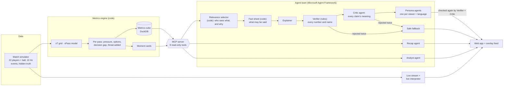

# Time and Space

[](https://github.com/falguni7/time-and-space/actions/workflows/ci.yml)

**▶ Live demo: https://falguni7.github.io/time-and-space/** · Demo video: *(link to follow)*

**How much time and space does the player on the ball really have, and what does it cost the team
when they don't?** Time and Space measures the pressure on every pass from tracking data and links it
to the threat the pass adds or loses. A team of AI agents explains the moments that matter, live, to
each viewer in their own way: a casual fan, an analyst, a supporter of either club, or the follower of
one player, in their own language. Every number in every text is checked against the data, and every
claim is reviewed by a Critic agent before anyone sees it.

All clubs, players and matches are fictional and simulated.

<!-- screenshot: docs/screenshot.png -->

## Try it

| How | Command | What you get |
|---|---|---|
| **In the browser** | open **https://falguni7.github.io/time-and-space/** | the full demo, nothing to install |
| **Docker** | `docker compose up --build`, then http://localhost:8000 | the same app, offline, no key, no cost |
| **Whole pipeline** | `docker compose --profile pipeline up --build pipeline`, then http://localhost:8001 | simulates the season, builds the engine, replays the agents, serves the app (a few minutes, ~2 GB) |

**What to click:**
- The app opens on **Live match**: the match plays with all 22 players, live statistics and an event
  ticker. **Your alerts** pop up on the right as your moments happen.
- Switch the **viewer** with the buttons at the top of the right-hand panel to see another fan's alerts
  and texts.
- Click an alert, or switch to **Key moments**, to see one moment on the animated pitch next to that
  viewer's explanation. The ★ 81' *Press wins the ball* moment runs straight into the press being
  broken and a goal.
- Below the pitch: the **match recap** for the selected viewer, and **Ask the analyst** with five league
  questions answered from the data.

**Where to find things:**

| To … | Look for |
|---|---|
| **follow one player all match** | the **follow** drop-down in the bar **directly under the pitch** (Live match), between the match timeline and the speed. Choose a player: a gold ring and tag follow them, and a player card appears on the right. Or pick the **Matteo Saltoro follower** viewer, which follows Saltoro automatically |
| change the match speed (1× to 90×) or jump in time | **speed** at the right end of the bar under the pitch; drag the timeline (gold marks = key moments, white = goals) |
| switch between the live match and single moments | **Live match / Key moments** at the top of the page, next to the score |
| see moments other viewers got | **show all moments** at the end of the moment list (Key moments) |
| see the facts behind a text, the neutral version, or what the checkers rejected | the expandable lines under each explanation (Key moments) |

## The idea: pressure → decision → threat

For every pass, from 10 Hz tracking of all 22 players and the ball:

| Measure | What it is |
|---|---|
| **Pressure** on the passer | from the nearest defender's distance (1 = within 1 m, 0 = nobody within 5 m) |
| **Passing options** | every teammate, with the chance the pass arrives (**xPass**, a model trained on the tracking) and the threat it would add |
| **Decision gap** | value of the best option minus the value of the chosen one |
| **Threat added (xT)** | change in the chance of scoring soon (expected-threat grid built from the season) |

Over a season they show what pressure does to a team. League-wide, the threat added per pass by
pressure on the passer:

| Third | no pressure | some pressure | high pressure |
|---|---|---|---|
| final third | +0.0009 | −0.0062 | −0.0095 |
| middle third | +0.0001 | −0.0014 | −0.0029 |
| defensive third | +0.0001 | −0.0002 | −0.0009 |

Each pressing moment is read against that curve at its own spot on the pitch: *"Under high pressure in
midfield the average pass loses threat (−0.0029); this one added +0.0433, more than 99% of the 13,767
league passes in the same situation."*

## From match events to a story for every fan

| Stage | What happens | Where |
|---|---|---|
| **Ingest** | The match arrives as a live stream of provider events (passes, shots, tackles, possession changes, pressure events, substitutions …). Each event is validated against a schema and rejected with a reason if malformed. | `stream/` · Live match view |
| **Interpret** | A live interpreter updates the match state with every event: score, possession, xG, threat created, pressure applied and faced, presses won, five-minute momentum. Per pass it adds distance, ball speed, xPass difficulty, pressure and threat; per shot, the shot speed. Behind it, the engine computes xT, xPass, decision gaps and a metrics cube for the whole league. | `stream/live.py`, `engine/` |
| **Explain** | Moment cards (press won, press broken, better pass missed, goal, big chance, momentum swing) are explained by the agent team: *why* it mattered, compared with the league. | `agents/` |
| **Render** | An animated pitch with the pressure ring, every passing option coloured by xPass, the chosen and the best pass, sprint badges and name tags. Every output is also a **timed, machine-readable feed** for broadcast overlays ([docs/overlay_feed.md](docs/overlay_feed.md)). | `web/` |
| **Personalize** | Each viewer gets their own feed of moments (the relevance selector says why each one is there), their own version of every text (tone, detail, club perspective, language, plain-language option) and a follow-player mode. | `agents/selector.py`, `agents/personas.py` |

## The agent team



| Agent | Role | Tools and checks |
|---|---|---|
| **Explainer** | writes the neutral explanation of a moment | the fact sheet; may call `player_profile`, `query_metrics` |
| **Verifier** (rules, not a model) | rejects any number not in the facts and any player or club not in the moment | the same fact sheet |
| **Critic** | reads each claim against the facts: invented causes, wrong direction (who won the ball), size words that contradict the data ("minimal" for a gap bigger than 94% of league passes) | temperature 0; can only reject, never add |
| **Persona agents** | rewrite the verified text for each viewer, club perspective and language | checked again by the Verifier and Critic |
| **Recap agent** | match summary per viewer | MCP tools |
| **Analyst agent** | answers league questions from the metrics cube, with sample sizes and confidence intervals, and says when a difference may be noise | MCP: `list_metrics`, `query_metrics`, `match_summary`, … |
| Relevance selector, fact sheet (code) | decide who sees which moment and why; gather what may be said | MCP tools |

**How they work together.**
- **Shared state:** one fact sheet per moment, built by code from the MCP tools. The writers, the
  Verifier and the Critic all work from that same reference. A draft carries its text, attempts and
  rejections from executor to executor.
- **Handoffs:** a Microsoft Agent Framework `WorkflowBuilder` graph routes each draft: Explainer →
  Verifier → Critic → approve, back to the writer with the reasons, or to the fallback. A fan-out sends
  the approved text to one Persona agent per viewer, and a collector gathers their versions.
- **Recovery:** a rejected draft goes back to its writer with the exact reasons. After two failures a
  safe text is shown and labelled: the verified neutral text, or a template written from the facts
  by code. A persona that cannot write the language falls back to English and says so.

In the recorded demo, the agents produced 92 texts: **66 passed first time, 22 after a rewrite, and 4
were replaced by the safe fallback**. Of 31 rejections, the Critic raised 25 (e.g. *"rewarding the
team's persistent pressure: the facts do not mention any team pressure"*) and the Verifier 6. Next to
every text the app shows which checks it passed and what was rejected before it.

## Built with

- **Azure AI Foundry**: `gpt-4.1-mini` deployment for every agent.
- **Microsoft Agent Framework**: agents, structured outputs and the `WorkflowBuilder` graph (switch-case
  routing, fan-out and fan-in, retries).
- **Model Context Protocol**: a read-only MCP server over the metrics engine, used by the agents through
  `MCPStdioTool`.
- **GitHub Actions and GitHub Pages**: every push runs the web tests, builds and smoke-tests the Docker
  image, and publishes the demo.
- Python 3.11, DuckDB, scikit-learn, FastAPI, Docker.

The model answers were recorded once (for the whole demo, 476 model calls including retries and
Critic reviews) and are replayed from `demo/llm_cache.sqlite`, so the app runs offline, free and
identically for everyone. `python -m presslens.agents.demo check` proves the replay makes no new model
call and reproduces every text exactly.

## What the app shows

- **Player identification:** the ball carrier's name tag, plus speed and distance; ⚡ sprint badges when a
  player passes 25 km/h; a follow-player mode with a live card (passes, accuracy, average pass
  difficulty, threat, pressure faced, distance, top speed, sprints).
- **Pass quality:** distance, accuracy (completion), difficulty rating (xPass in words), pressure, threat.
- **Speed:** ball speed of every pass and shot speed of every shot.
- **Narratives:** moment explanations, match recaps per viewer, player context (season profile).
- **Explainability:** pressure against the league curve, decision gaps, momentum swings.
- **Data:** a simulated season of 56 matches with tracking, events, phases and hidden ground truth.
- **Languages:** English, German and Spanish in the demo; any language the model writes.
- Not included: auto-eventing from video. The events come from the simulator's provider feed.

## Does it measure the right thing?

The simulator keeps hidden ground truth that the engine never reads (`engine/data.py` refuses it).
Validation on 16 held-out matches (written to `data/engine/validation_report.md` by
`presslens.engine build`):

| Engine estimate | vs hidden truth |
|---|---|
| xT grid (96 zones) | Pearson 0.964 |
| xPass (17,706 test passes) | correlation 0.920, AUC 0.823 |
| Decision gap | Spearman 0.436 |
| Pressure applied by each club (middle third) vs its true press intensity | Spearman 0.976 |

The engine also rediscovers the effect built into the players: under high pressure, low-composure
players' decision gap grows to 0.0041 (truth 0.0064) against 0.0032 for high-composure players.
Season realism (56 matches): 2.48 goals and 2.56 xG per match, 74% pass completion, 11.5 km per player
(`presslens.sim.realism`).

## Running it step by step

Development used an Apptainer container through `bin/pl`. Any Python 3.11 with
`docker/requirements-pipeline.txt` works the same way.

```bash
python -m presslens.sim generate                    # 56-match season -> data/matches (~45 s)
python -m presslens.engine build                    # xT, xPass, decisions, cube, moments, validation (~30 s)
python -m presslens.mcp_server                      # the MCP server (stdio) with the agents' tools
python -m presslens.agents.demo build --backend azure   # record the demo (~$0.25), or: check (offline)
python -m presslens.agents.evaluate --backend azure --max-matches 8   # held-out evaluation report
python -m presslens.stream feed                     # live feed -> demo/live/
python -m presslens.stream replay R01_RIV-STO --speed 20   # watch the live interpreter in a terminal
python -m presslens.web.clips                       # clips, full-match tracking, page data -> demo/
python -m presslens.web.server                      # http://localhost:8000 (also streams the feed as SSE)
python -m presslens.web.site                        # static site -> build/site
python -m pytest                                    # 96 tests, offline (scripted model)
```

To re-run the agents live, put your own Azure AI Foundry deployment in `.env` (`AZURE_AI_ENDPOINT`,
`AZURE_AI_API_KEY`, `AZURE_AI_DEPLOYMENT`).

## Repository

| Path | What |
|---|---|
| `src/presslens/sim` | match simulator: movement, tactics, pressing, decisions, set pieces, hidden truth |
| `src/presslens/stream` | live replay stream, event schema, live interpreter |
| `src/presslens/engine` | xT, xPass, per-pass decisions, metrics cube, moment cards, validation |
| `src/presslens/mcp_server` | MCP server: 9 read-only tools over the engine |
| `src/presslens/agents` | fact sheets, Verifier, Critic, personas, selector, workflow, demo and evaluation |
| `src/presslens/web` | clip and tracking export, FastAPI server, static site, the page |
| `demo/` | recorded demo: texts, model-answer cache, clips, live feed |
| `docs/overlay_feed.md` | the timed feed format for overlays |
| `docker/`, `.github/workflows/` | Docker images, pinned requirements, CI and Pages |

## Limits

- The data are simulated. The method needs only player and ball positions plus pass events, which
  tracking providers supply, but it has not been run on real matches here.
- The Critic is a model and can miss things. The rule-based Verifier is the hard guarantee for numbers and
  names.
- The decision gap agrees with the truth only moderately (Spearman 0.44), because judging one pass is
  noisy. Season and team aggregates are much more reliable than any single pass. Getting real match data also makes it more reliable.
- The demo covers one match. Explaining another means recording its texts.

## License

MIT. All clubs, players and match data are fictional and synthetic.
